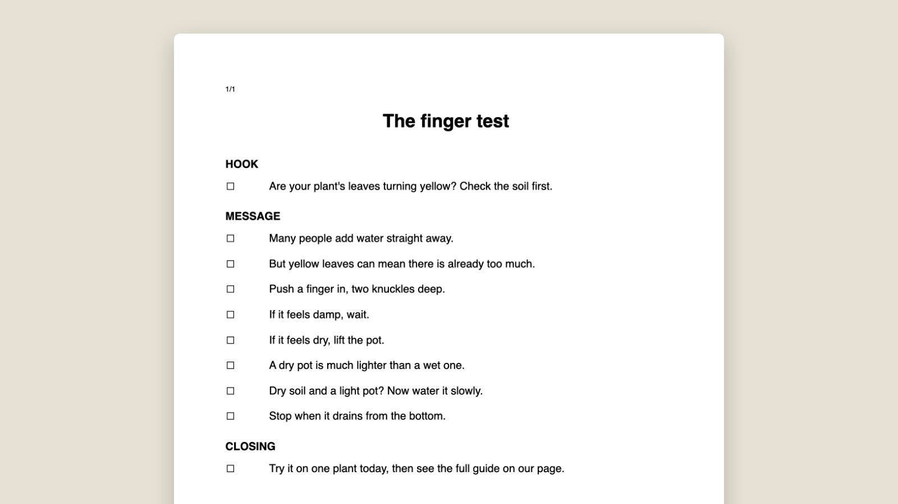
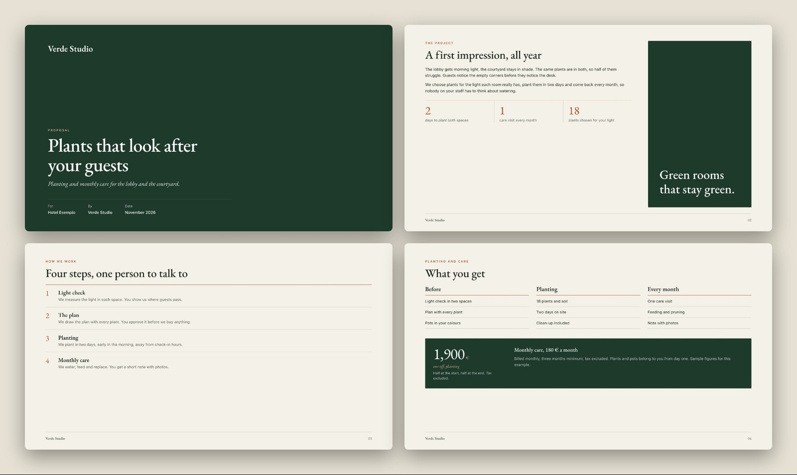
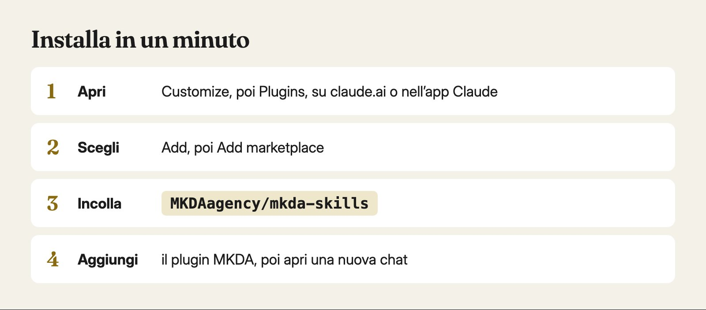
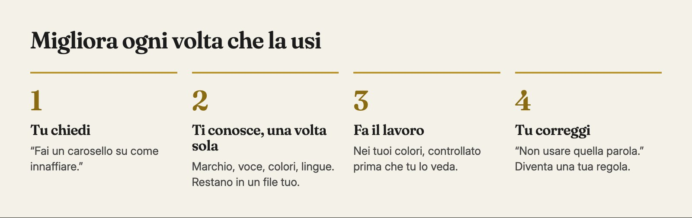
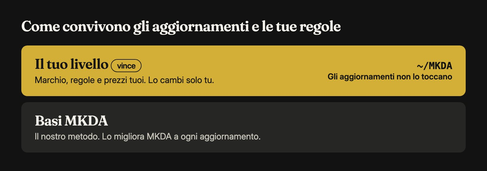

[](#installazione)

[English](README.md) · **Italiano**

# MKDA Skills

**Di' a Claude cosa ti serve. Ricevi un lavoro che somiglia alla tua attività.**

Claude è un assistente AI. Una *skill* è un insieme di istruzioni che gli insegna un mestiere. Queste tre nascono dal metodo di [MKDA Digital Marketing Agency](https://mkdaagency.com). Sono gratuite, non serve saper programmare e lavorano nella tua lingua.

**[Installa](#installazione)** · [Cosa ottieni](#cosa-ottieni) · [Primo messaggio](#il-primo-messaggio) · [Come impara](#come-impara) · [Domande](#domande)

## Cosa ottieni

Gli esempi sono stati fatti con queste skill per un marchio inventato.

### 🎨 mkda-content: da un'idea ai post


Caroselli, storie, reel e didascalie. Studia il tema, ti mostra la storyboard, disegna le pagine e controlla che i testi si leggano e niente si sovrapponga.

> "Fai un carosello su come innaffiare le piante senza esagerare."

<details>
<summary>Guarda un reel</summary>


</details>

### 🎬 mkda-script: video pronti da girare



Gancio, messaggio e chiusura, in frasi fatte per essere dette. Ricevi un documento Word con una casella da spuntare dopo ogni ripresa.

> "Scrivi 5 script video per la mia attività, giriamo giovedì."

### 📄 mkda-proposals: preventivi da mandare



Un PDF 16:9 con i tuoi servizi. **I prezzi li metti sempre tu**: non ne inventa e non invia niente senza il tuo sì.

> "Prepara un preventivo per un hotel: piante e cura mensile."

## Installazione

### Il modo facile: senza terminale



1. Apri **[claude.ai/customize/plugins](https://claude.ai/customize/plugins)** e accedi (oppure **Customize > Plugins** nell'app Claude).
2. Scegli **Add**, poi **Add marketplace**.
3. Incolla questo e conferma:

   ```
   MKDAagency/mkda-skills
   ```
4. Apri il plugin **MKDA**, scegli **Add**, poi apri una **nuova** chat.

Resta salvato nel tuo account: lo trovi in chat, Cowork e Claude Code. I menu possono cambiare e, con un account aziendale, può servire il permesso di un Owner.

<details>
<summary><b>Altri modi: Claude Code, o una sola skill in zip</b></summary>

**Claude Code.** Scrivi questi comandi uno alla volta:

```
/plugin marketplace add MKDAagency/mkda-skills
```
```
/plugin install mkda@mkda-skills
```

**Una skill in zip.** Scaricala dall'[ultima versione](https://github.com/MKDAagency/mkda-skills/releases/latest) senza aprire lo zip. In [Customize > Skills](https://claude.ai/customize/skills) scegli **+**, **Create skill**, **Upload a skill**. In **Settings > Capabilities** deve essere attiva l'esecuzione del codice.

</details>

### Quale app uso?

| | Adatta a |
|---|---|
| **Chat di Claude** | testi, script e storyboard; file quando gli strumenti sono disponibili |
| **Cowork** | file e cartelle del computer, secondo strumenti e permessi |
| **Claude Code** | tutto, video finiti compresi |

## Il primo messaggio

Apri una nuova chat e copia uno di questi:

```
Usa mkda-script. Ho [la tua attività]. Scrivi 5 script video.
```
```
Usa mkda-content. Fai un carosello su [tema].
```
```
Usa mkda-proposals. Prepara un preventivo per [cliente] per [servizio].
```

Puoi anche scrivere `/` e scegliere la skill. La prima volta ti fa qualche domanda: tieni pronti sito, logo e colori.

## Come impara



Di' cosa non va con parole tue: *"Troppo formale"*, *"Non usare quella parola"*, *"Il nostro verde è più scuro"*. Corregge il lavoro e tiene la regola per la volta dopo.



- In **Claude Code** le tue regole restano nella cartella `MKDA` dentro la tua cartella utente, anche se disinstalli. Tienine una copia.
- In **chat** la skill ti dà un file chiamato `mkda-profile.md`. Mettilo nel tuo Progetto o allegalo la volta dopo, altrimenti non se ne ricorderà.
- Hai cambiato idea? Scrivi *"dimentica quella regola"*.

## Aggiornamenti

Aggiunta da **Customize > Plugins**: gli aggiornamenti arrivano nel tuo account quando il marketplace si sincronizza. Per controllare subito, **Check for updates** nella pagina Plugins.
Aggiunta da **Claude Code**: scrivi `/plugin`, vai su **Marketplaces**, scegli `mkda-skills` e attiva l'aggiornamento automatico.
Aggiunta come zip: carica quello nuovo.

## Domande

<details>
<summary><b>È gratis?</b></summary>

Le skill sì. Serve un account Claude; cosa puoi fare dipende dal tuo piano e dai suoi limiti.
</details>
<details>
<summary><b>MKDA vede i miei dati?</b></summary>

No. Le skill non inviano niente a MKDA. Claude elabora le conversazioni secondo i termini di Anthropic e, quando una skill studia un tema, visita pagine web.
</details>
<details>
<summary><b>L'ho installata ma Claude non la usa</b></summary>

Apri una nuova chat, controlla che il plugin sia attivo in **Customize > Plugins** e nomina la skill: "Usa mkda-content". In Claude Code scrivi `/reload-plugins`.
</details>
<details>
<summary><b>Dice che manca uno strumento</b></summary>

Pagine e video richiedono strumenti. La skill ti dice quali, e installa quelli che può solo se dici di sì. Gli script usano Python; i preventivi Python con Playwright, Pillow e pypdf; i contenuti Node 22, più ffmpeg per i video. Senza, ricevi comunque testi e storyboard.
</details>
<details>
<summary><b>Può pubblicare o mandare email per me?</b></summary>

Non senza il tuo sì a quell'azione.
</details>
<details>
<summary><b>Lavoro per più clienti</b></summary>

Di' per quale cliente è il lavoro: ognuno ha un file con le sue regole.
</details>
<details>
<summary><b>Windows e Linux?</b></summary>

Gli script si provano lì in automatico. PDF e video finiti, per ora, sono stati provati solo su macOS.
</details>

Serve aiuto? [Apri una segnalazione](https://github.com/MKDAagency/mkda-skills/issues/new), senza dati privati.

## Fatto da MKDA

Vuoi qualcuno che lo faccia con te? **[mkdaagency.com](https://mkdaagency.com)**

Le skill possono eseguire comandi sul tuo computer: leggile prima di installarle, come ogni plugin. [Apache-2.0](LICENSE), nome e logo MKDA esclusi. Gli aggiornamenti li pubblica solo MKDA. [Novità](CHANGELOG.md)
