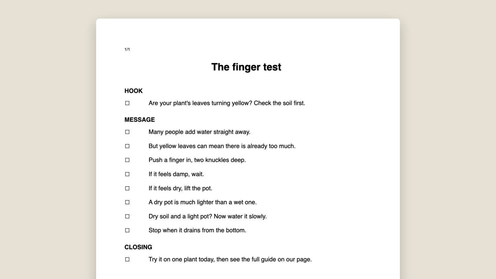
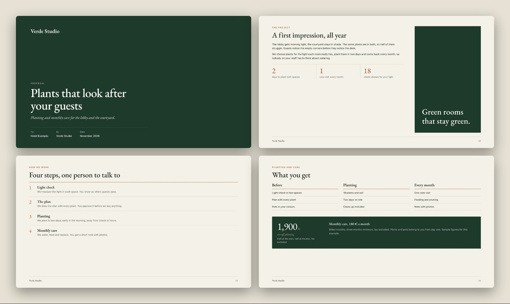
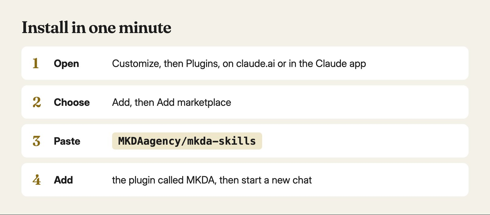
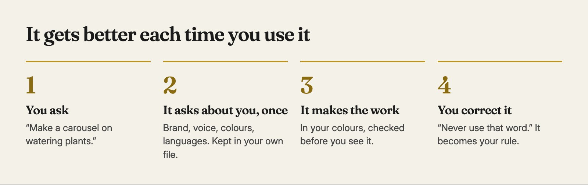
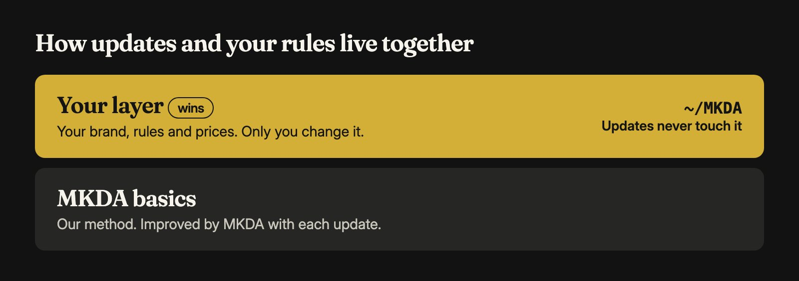

[](#install)

**English** · [Italiano](README.it.md)

# MKDA Skills

**Tell Claude what you need. Get work that looks and sounds like your business.**

Claude is an AI assistant. A *skill* is a set of instructions that teaches it a job. These three come from the method of [MKDA Digital Marketing Agency](https://mkdaagency.com). They are free, you don't need to know how to code, and they work in your language.

**[Install](#install)** · [What you get](#what-you-get) · [First message](#your-first-message) · [How it learns](#how-it-learns) · [Questions](#questions)

## What you get

Everything below was made with these skills for an invented brand.

### 🎨 mkda-content: from an idea to posts


Carousels, stories, reels and captions. It researches the topic, shows you the storyboard, draws the pages and checks that text is readable and nothing overlaps.

> "Make a carousel on how to water plants without drowning them."

<details>
<summary>See a reel</summary>


</details>

### 🎬 mkda-script: videos ready to film



Hook, message and closing, in lines made to be spoken. You get a Word document with a box to tick after each take.

> "Write 5 video scripts for my business, we film on Thursday."

### 📄 mkda-proposals: proposals worth sending



A 16:9 PDF with your services. **Prices always come from you**: it never invents one, and never sends anything without your yes.

> "Prepare a proposal for a hotel: planting and monthly care."

## Install

### The easy way: no terminal



1. Open **[claude.ai/customize/plugins](https://claude.ai/customize/plugins)** and sign in (or **Customize > Plugins** in the Claude app).
2. Choose **Add**, then **Add marketplace**.
3. Paste this and confirm:

   ```
   MKDAagency/mkda-skills
   ```
4. Open the plugin **MKDA**, choose **Add**, then start a **new** chat.

It is saved to your account, so you find it in chat, Cowork and Claude Code. Menus can change and, with a company account, an Owner may have to allow it.

<details>
<summary><b>Other ways: Claude Code, or a single skill as a zip</b></summary>

**Claude Code.** Type these one at a time:

```
/plugin marketplace add MKDAagency/mkda-skills
```
```
/plugin install mkda@mkda-skills
```

**One skill as a zip.** Download it from the [latest release](https://github.com/MKDAagency/mkda-skills/releases/latest) without unzipping it. In [Customize > Skills](https://claude.ai/customize/skills) choose **+**, **Create skill**, **Upload a skill**. Code execution must be on in **Settings > Capabilities**.

</details>

### Which app should I use?

| | Best for |
|---|---|
| **Claude chat** | texts, scripts and storyboards; files when the tools are available there |
| **Cowork** | files and folders on your computer, depending on its tools and permissions |
| **Claude Code** | everything, finished videos included |

## Your first message

Open a new chat and copy one of these:

```
Use mkda-script. I run a [your business]. Write 5 video scripts.
```
```
Use mkda-content. Make a carousel about [topic].
```
```
Use mkda-proposals. Prepare a proposal for [client] for [service].
```

You can also type `/` and pick the skill. The first time it asks a few questions: have your website, logo and colours at hand.

## How it learns



Say what is wrong in plain words: *"Too formal"*, *"Never use that word"*, *"Our green is darker"*. It fixes the work and keeps the rule for next time.



- In **Claude Code** your rules stay in the `MKDA` folder in your user folder, even if you uninstall. Keep a copy of it.
- In **chat**, the skill gives you a file called `mkda-profile.md`. Put it in your Project, or attach it next time, otherwise it will not remember.
- Change your mind? Say *"forget that rule"*.

## Updates

Added from **Customize > Plugins**: updates reach your account when the marketplace syncs. To check now, use **Check for updates** on the Plugins page.
Added from **Claude Code**: type `/plugin`, go to **Marketplaces**, pick `mkda-skills` and turn auto-update on.
Added as a zip: upload the new one.

## Questions

<details>
<summary><b>Is it free?</b></summary>

The skills are. You need a Claude account; what you can do depends on your plan and its limits.
</details>
<details>
<summary><b>Does MKDA see my data?</b></summary>

No. The skills send nothing to MKDA. Claude processes your conversations under Anthropic's terms, and when a skill researches a topic it visits web pages.
</details>
<details>
<summary><b>I installed it but Claude doesn't use it</b></summary>

Start a new chat, check that the plugin is on in **Customize > Plugins**, and name the skill: "Use mkda-content". In Claude Code type `/reload-plugins`.
</details>
<details>
<summary><b>It says a tool is missing</b></summary>

Pages and videos need tools. The skill tells you which, and installs the ones it can only if you say yes. Scripts need Python; proposals need Python with Playwright, Pillow and pypdf; content needs Node 22, plus ffmpeg for video. Without them it still gives you texts and storyboards.
</details>
<details>
<summary><b>Can it publish for me or send emails?</b></summary>

Not without your yes to that action.
</details>
<details>
<summary><b>I work for several clients</b></summary>

Say which client the job is for: each one gets its own file with its own rules.
</details>
<details>
<summary><b>Windows and Linux?</b></summary>

The scripts are tested there automatically. Finished PDFs and videos have been tried on macOS only so far.
</details>

Still stuck? [Open an issue](https://github.com/MKDAagency/mkda-skills/issues/new), without private data.

## Made by MKDA

Want someone to do it with you? **[mkdaagency.com](https://mkdaagency.com)**

Skills can run commands on your computer: read them before installing, as with any plugin. [Apache-2.0](LICENSE), MKDA name and logo excluded. Only MKDA publishes updates here. [Changes](CHANGELOG.md)
